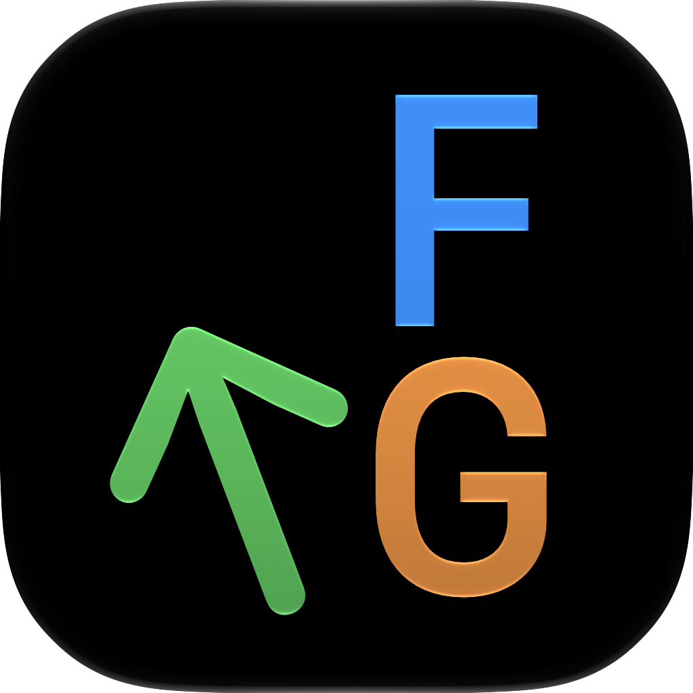

  

<h1 align="center">Field Glance</h1>

  Local time, UTC time, and magnetic declination — at a glance. 
  For iPhone and Apple Watch.

---

Three pieces of information on a black screen...

- **Local time** — date and time in your current time zone
- **UTC** — date and time in UTC
- **Magnetic declination** — the current value at your location indicated with a compass
  arrow

...and nothing else. No accounts, no settings, no network requests.

## Targets

| Target              | Description                            |
| ------------------- | -------------------------------------- |
| `FieldGlance`       | iPhone app                             |
| `FieldGlanceWatch`  | Apple Watch app                        |
| `FieldGlanceWidget` | Watch complications (UTC, declination) |

## Requirements

- Xcode 27 or later
- iOS and watchOS versions: see **Minimum Deployments** in each target's General tab

## Notes

Declination is computed with the
[World Magnetic Model 2025](https://www.ncei.noaa.gov/products/world-magnetic-model)
(WMM2025), which is valid through 2029. The app shows a warning when the model is out of
date.

The app icon is built from `icon/field-glance.svg`. See
[`icon/README.md`](icon/README.md) for how it is exported and composed.

> 🤖 Built using Claude and Kiro, with a human in the loop.
