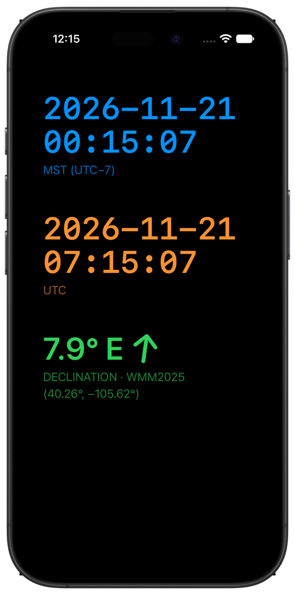
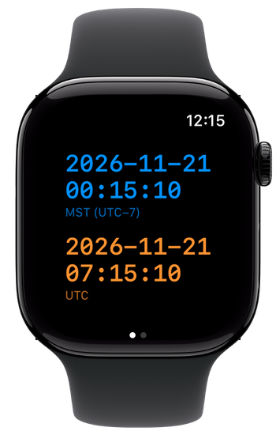
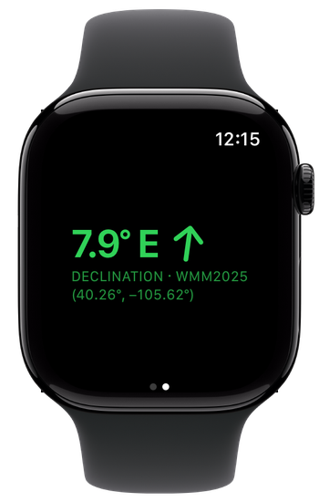

# Field Glance

Local time, UTC time, and magnetic declination — at a glance. For iPhone and Apple
Watch.

  
  

    
    
  

## What it shows

Three pieces of information on a black screen:

- **Local time** — date and time in your current time zone
- **UTC** — date and time in UTC
- **Magnetic declination** — the current value at your location, with a compass arrow
  showing which way the magnetic field points relative to true north

...and nothing else. No accounts, no settings, no network requests.

> On Apple Watch, UTC time and declination are also available as complications.

## About the declination model

Declination is computed on your device with the
[World Magnetic Model 2025](https://www.ncei.noaa.gov/products/world-magnetic-model)
(WMM2025), which is valid through 2029. The app shows a warning when the model is out of
date. For details on how the model was built, see the
[WMM2025 technical report](https://doi.org/10.25923/prbc-s316).

## Privacy

Field Glance uses your location only to calculate declination, and your location never
leaves your device. See the [privacy policy](privacy-policy.md) for details.

## Source code

Field Glance is open source under the MIT License. The code is on GitHub at
[**liamtoney/field-glance**](https://github.com/liamtoney/field-glance).

## Support

Questions or bug reports? Email
<a href="mailto:liam@liam.earth" class="email">liam@liam.earth</a>.
